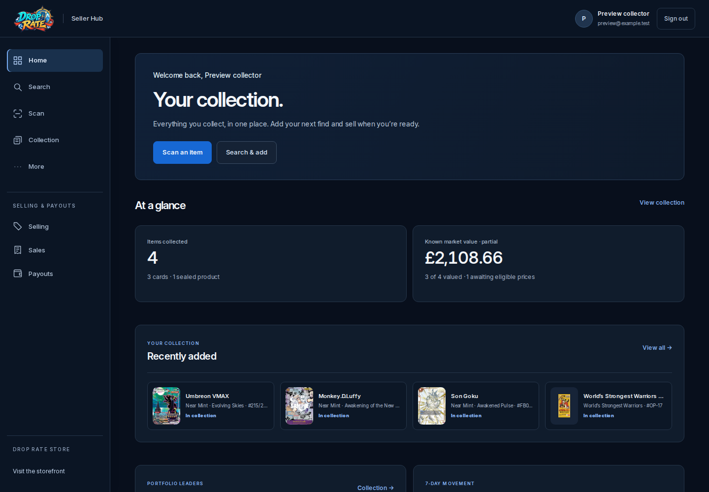
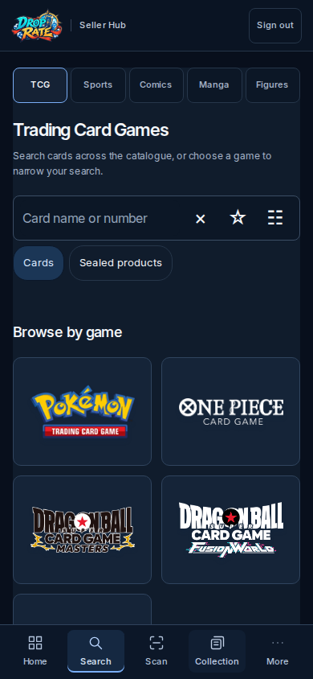
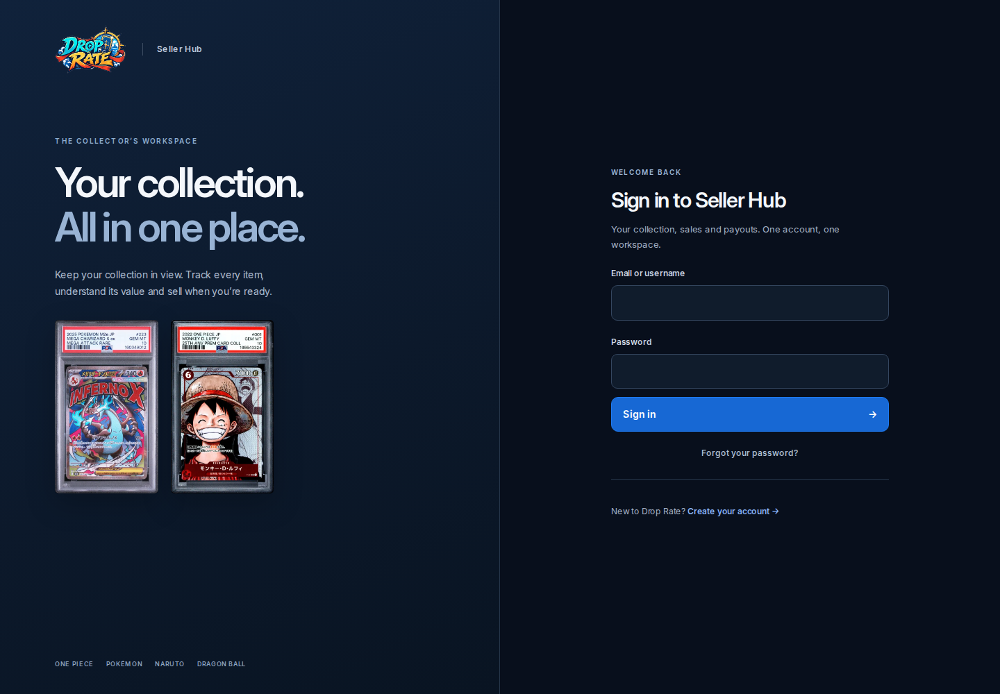

# Premium Seller Hub

## Purpose

Bring the Seller Hub into the same visual family as the Shopify Brand Redesign,
with a dark workspace to distinguish it from the light storefront. Reorganise
discovery around the categories people collect and make collection, selling,
money and account tools easier to find.

## Design decisions

- Use the same Drop Rate logo artwork as the storefront. The existing approved
  transparent asset is shared by sign-in, registration, loading screens, the
  workspace header, the launch page and favicons. Product names are separate text,
  rather than alternate logos with embedded ribbons.
- Match the storefront's Inter typography, blue actions and restrained borders.
  The workspace uses a deep navy canvas (`#080f1c`), raised navy panels
  (`#101c2c`) and a slightly darker blue for legible white button labels
  (`#1768d4`). Authentic catalogue artwork supplies the colour.
- Reduce decorative patterns, comic-style shadows, novelty symbols and oversized
  headings. Use consistent line icons, compact data cards and calmer spacing.
- Keep mobile inputs at a readable size, primary controls at least 44 px high,
  visible keyboard focus and the existing reduced-motion preference.
- Preserve existing saved appearance keys. Their labels now describe subtle
  accent colours; they no longer replace the dark workspace with themed surfaces.

## Organisation

The five primary destinations remain Home, Collection, Scan, Search and More.
Desktop navigation adds direct access to the role's existing Selling, Sales and
Payouts controls. These shortcuts are derived from controls the role already has.

More groups the existing tools into:

1. Collection tools, when present for the signed-in role.
2. Selling, including sales and channels.
3. Payouts & finance, including settlements and reports.
4. Account & settings, including business administration where available.

The back control returns to More and restores focus to the originating tool.
Collection remains the starting point; listing an item for sale is a separate,
deliberate action.

## Search categories

| Category | Existing catalogue mapping | Behaviour |
| --- | --- | --- |
| Trading Card Games | `CARD` / `SEALED`, with optional game scope | Search actual cards directly, narrow by game, or switch to sealed products. |
| Sports Cards | No connected catalogue | Show a clear unavailable state; do not send an unsupported query or display unrelated results. |
| Comics | `COMIC` with `system_code=COMICS` | Search the existing comics catalogue separately from manga. |
| Manga | `COMIC` with `system_code=MANGA` | Search the existing manga catalogue separately from comics. |
| Figures | No connected catalogue | Show a clear unavailable state; do not invent catalogue records or product types. |

Category changes clear incompatible game, set and type selections. TCG defaults
to cards so an unscoped text query cannot mix book results into the category.
Specific item detail, physical-copy selection and Add to collection keep their
existing handlers and request contracts.

## Implementation boundaries

The dark theme is a final, scoped presentation layer in `premium-hub.css` and
`premium-auth.css`, after the existing feature styles. It covers both seller and
founder workspaces, including dialogs, imports, account forms and fulfilment.
Cache versions are advanced for the changed shared assets.

This change adds no database migrations, new catalogue types, permission grants,
valuation logic, payment operations or order state transitions. The catalogue
request changes use existing filter parameters only. Reference art remains
distinct from photographs of a seller's physical copy, and missing valuations
remain explicitly unavailable or partial.

## Assets

- `brand-assets/storefront-logo.png`: existing approved transparent Drop Rate
  artwork, visually checked against the Shopify Brand Redesign header.
- `fonts/InterVariable.woff2`: official Inter variable font from the
  [Inter project](https://github.com/rsms/inter), self-hosted with its
  `Inter-LICENSE.txt` SIL Open Font License.
- Sign-in artwork: the existing real photographed Charizard and Luffy slabs in
  `collection-photos`; no generated product artwork.

## Verification and limits

Local release checks completed on 3 November 2026:

| Check | Result |
| --- | --- |
| Full Python regression suite | 8,771 passed; 25 optional PGlite checks skipped because that isolated runtime is not installed locally. |
| Complete `tests/ui` npm suite | Passed, including eight new category interaction groups and the real book-intake handoff. |
| Responsive browser fixture | 104 states passed at 320, 390, 768 and 1440 px; no page errors, unintended horizontal overflow or sampled text contrast below 4.5:1. |
| Python compilation and static JavaScript syntax | Passed. |

The regression suites exercise existing collection, scanner, catalogue, signup,
navigation and fulfilment behaviour. The new category checks verify real request
scopes, category resets and unavailable categories without provider calls.

`tests/ui/premium-hub-browser.py` renders the actual HTML, CSS and JavaScript with
synthetic account and inventory fixtures at 320, 390, 768 and 1440 px. It checks
navigation, page overflow, dark native controls, text contrast and dialog layout.
Every network request outside the isolated fixture origin is blocked; mutations
are rejected. Screenshots from this harness are previews, not customer data or
proof of live authenticated workflows.

Production verification checks the deployed revision, readiness and public entry
screens. Real phone camera capture, authenticated customer accounts and live order
or payout operations require their own acceptance checks and are not claimed by
this UI work.

## Visual evidence

These captures use the real application assets with synthetic accounts and
collection values. They are design previews, not live customer records.

## Rollback

Revert this UI commit as a unit and redeploy the resulting revision. No data
migration or restoration is needed. Keep the JavaScript, stylesheets, HTML cache
versions and tests together when reverting.
